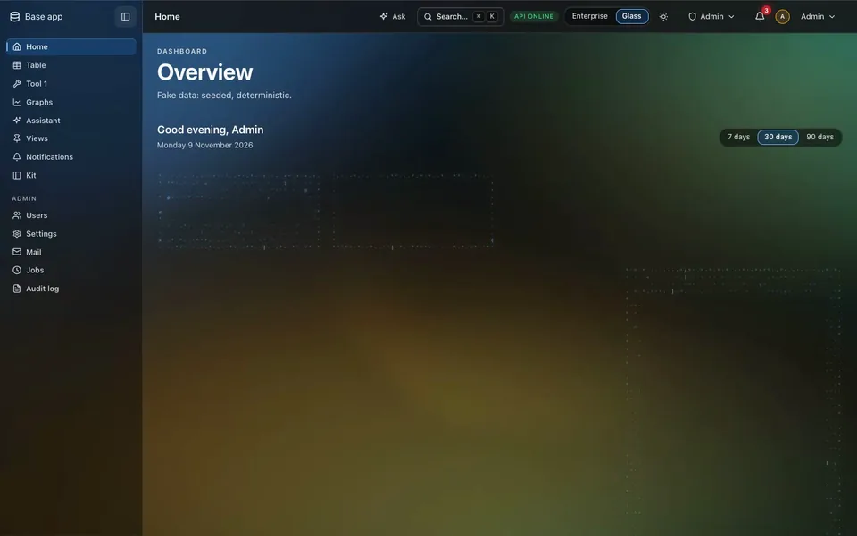

  <picture>
    <source media="(max-width: 767px) and (prefers-color-scheme: light)" srcset="./assets/banner-mobile-light.svg" />
    <source media="(max-width: 767px)" srcset="./assets/banner-mobile.svg" />
    <source media="(prefers-color-scheme: light)" srcset="./assets/banner-light.svg" />
    
  </picture>

<b>Choices beat talent. Shipping beats credentials.</b>

  <a href="https://ncs.agency/"><picture><source media="(prefers-color-scheme: light)" srcset="./assets/link-ncs-light.svg" /></picture></a>
  <a href="https://www.linkedin.com/in/george-allan-3479a0237"><picture><source media="(prefers-color-scheme: light)" srcset="./assets/link-linkedin-light.svg" /></picture></a>

## About

I'm a software engineer at **NCS**, specialising in agentic systems: the harnesses that let a whole engineering team ship with AI agents.

**Geology BSc** → **geotechnical engineer** → **self-taught developer** → **software engineer**

## 🐝 Hive

A multi-agent orchestration system for Claude Code that I built. Hand it a pile of work and it runs a team of agents through it, without melting your machine.

<picture>
  <source media="(prefers-color-scheme: dark)" srcset="./assets/hive-architecture.png" />
  <source media="(prefers-color-scheme: light)" srcset="./assets/hive-architecture-light.png" />
  
</picture>

## Also built

**Glasswork UI**: the React component kit and app template I build with. Two skins, light and dark, and an assistant that acts through the app.

**Quore Geotechnical**: snap a photo of handwritten borehole logs and AI turns them into industry-standard `.ags` data.

<a href="https://quoresoftware.com/quore-geotechnical"><picture><source media="(prefers-color-scheme: light)" srcset="./assets/link-quore-light.svg" /></picture></a>

**Furniture Friends**: a pro-bono AI inventory system for a local furniture charity.

<a href="https://www.datchworth.com/furniture-friends/"><picture><source media="(prefers-color-scheme: light)" srcset="./assets/link-furniture-friends-light.svg" /></picture></a>

<!--
## Writing
Uncomment once the first post is up — notes on building agent harnesses.
- [Post title](https://link) — one-line summary
-->
