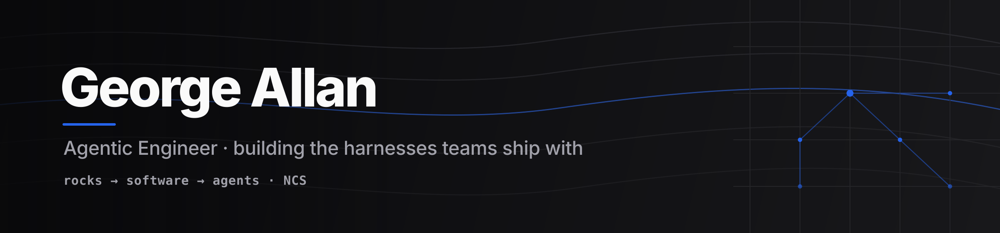
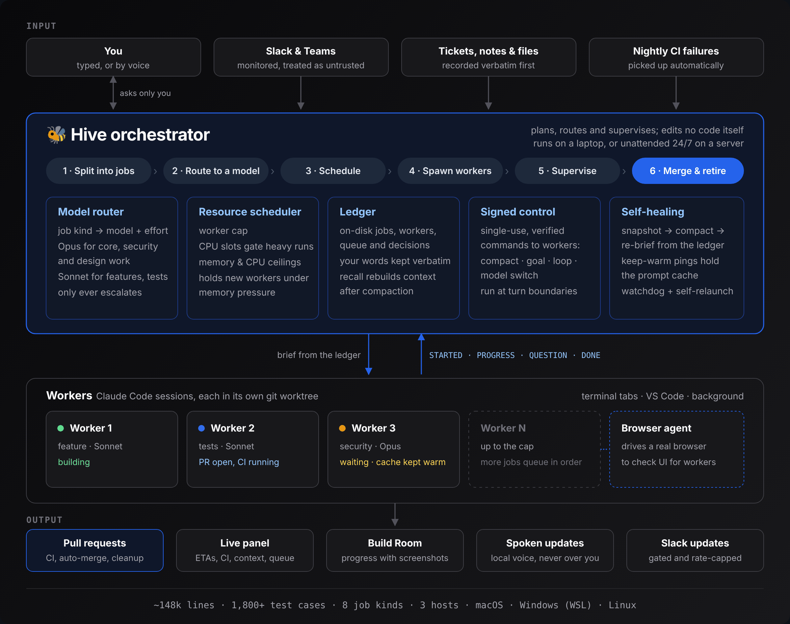

  <picture>
    <source media="(prefers-color-scheme: dark)" srcset="./banner-strata.png" />
    <source media="(prefers-color-scheme: light)" srcset="./banner-strata-light.png" />
    
  </picture>

<b>Choices beat talent. Shipping beats credentials.</b>

  
  

## About Me

I'm an **agentic engineer** at **NCS**, an AI-first engineering consultancy. I build the harnesses, skills and orchestration that let a whole engineering team ship with AI agents, and I got here without a CS degree.

I studied **Geology** at Southampton and taught myself to code the long way round: PineScript trading bots, then Python, then a weekend app that turned muddy, handwritten borehole logs into structured `.ags` data with an AI handwriting model. That's when it clicked: the thing I built on weekends for free was the thing I should be paid to do on a Monday.

<table>
  <tr>
    <td width="50%" valign="top">
      <b>What I'm About</b>
      <ul>
        <li>Agents are only as good as their harness</li>
        <li>Secure, correct code over quick hacks</li>
        <li>Understanding the <em>why</em> behind every decision</li>
        <li>Shipping &mdash; done beats perfect</li>
      </ul>
    </td>
    <td width="50%" valign="top">
      <b>The Roundabout Path</b>
      <ul>
        <li>BSc Geology &mdash; University of Southampton</li>
        <li>Geotechnical Engineer &mdash; Ian Farmer Associates (RSK)</li>
        <li>Associate Software Engineer &mdash; NCS, specialising in agentic &amp; harness engineering</li>
      </ul>
    </td>
  </tr>
</table>

## What I've Built

### 🐝 Hive — *multi-agent orchestration for Claude Code*

I designed and built Hive, a multi-agent orchestration system that's been adopted across the company. Hive splits a batch of work into independent jobs and runs each one in its own Claude Code session, so engineers direct the work instead of babysitting one chat at a time.

- **Token-efficient by design:** keeps each waiting agent's prompt cache warm, so it doesn't pay for a full cache rebuild when it picks back up
- **Resource-aware:** manages CPU load so running many agents doesn't grind a dev machine to a halt
- **Adopted company-wide:** it started as my own workflow and became the default way of building

<picture>
  <source media="(prefers-color-scheme: dark)" srcset="./assets/hive-architecture.png" />
  <source media="(prefers-color-scheme: light)" srcset="./assets/hive-architecture-light.png" />
  
</picture>

### Quore Geotechnical — *instant, client-ready site intelligence*

The product that turned me from a geotechnical engineer into a software engineer. Borehole logs came back from site mud-smeared and half-illegible, and someone retyped them by hand into HoleBASE / OpenGround, which took hours per site. With Quore you snap a photo of the notes, an **AI handwriting model** extracts the data, and the app exports standards-compliant **`.ags`** files straight into the industry databases.

### Furniture Friends — *AI inventory management for a local charity*

A pro-bono build for **Furniture Friends**, a Datchworth charity that finds new homes for donated furniture. It replaced their manual stock-keeping with an **AI-powered inventory system**, so volunteers can see what's come in, what's available and where it's gone without wrestling a spreadsheet.

<!--
## Writing
Uncomment once the first post is up — notes on building agent harnesses.
- [Post title](https://link) — one-line summary
-->

## Stack

**Languages** — TypeScript · JavaScript · Python · Bash 
**Runtime** — Node.js · React · Next.js 
**Data & infra** — PostgreSQL · Docker · Turborepo 
**Agentic** — Claude Code · skills & sub-agents · prompt caching 
**Workflow** — Git · pnpm · Warp · Obsidian · Wispr Flow
